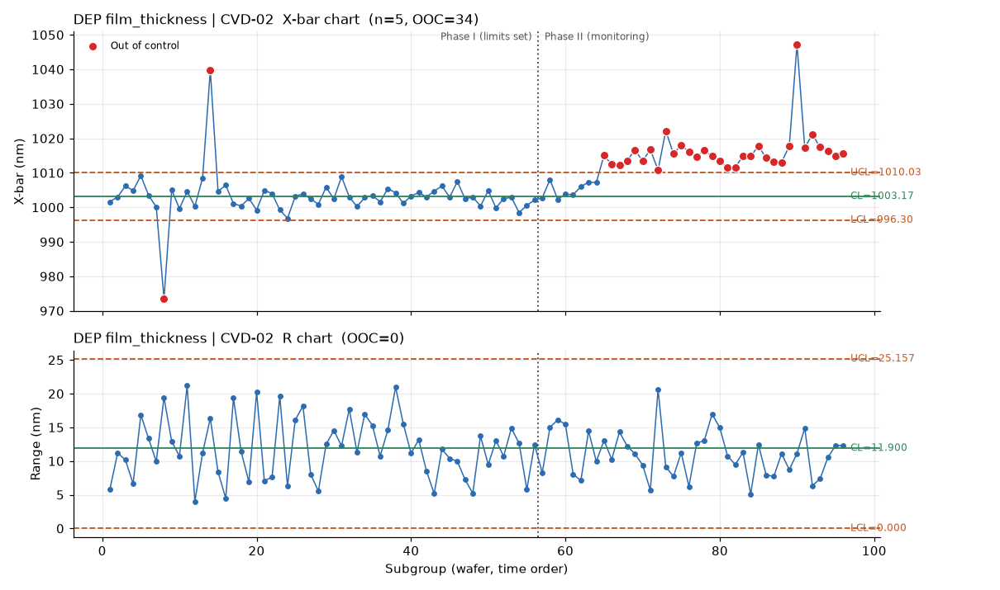
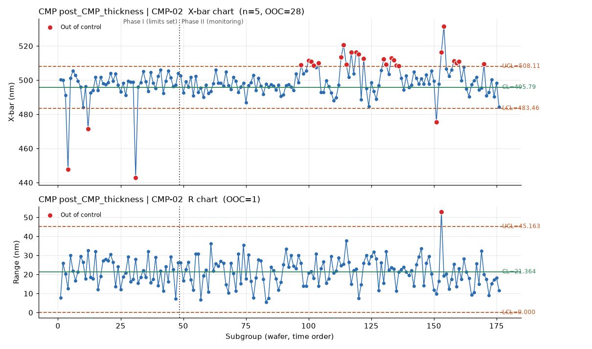

# spc-report

반도체 공정 측정 데이터를 모아 **SPC(Statistical Process Control, 통계적 공정 관리) 리포트**를 엑셀 파일로 자동 생성하는 Python 프로젝트입니다.

- STI(소자 분리) 형성을 단순화한 **5개 공정 흐름**(산화 → 포토 → 식각 → 증착 → CMP)의 핵심 계측 항목을 다룹니다.
- 공정·장비별 **X-bar–R 관리도**(Phase I로 관리 한계를 정하고 Phase II를 감시, 관리 한계를 벗어난 점 강조)를 그립니다.
- **같은 웨이퍼를 모든 공정에 걸쳐 추적**할 수 있도록 데이터를 연결합니다(`WaferTrace`). 공정 간 영향 분석의 기반이 됩니다.
- 공정 단계는 코드를 고치지 않고 **설정 파일(`process_flow.toml`)만으로 추가하거나 바꿀 수 있습니다.**

실제 데이터가 없어도 연습할 수 있도록, 이상치와 공정 간 영향을 심어 둔 **가상 측정 데이터 생성기**를 함께 제공합니다.



> **DEP / CVD-02**: 점선 왼쪽(Phase I, 처음 5일)으로 관리 한계를 정하고, 오른쪽(Phase II)을 그 한계로 감시합니다. 11/11부터 넣은 +12 nm 평균 이동이 UCL 위로 연속해서 나타납니다.



> **CMP / CMP-02**: 증착 두께는 CMP 후 두께에 영향을 줍니다(계수 0.7). 그래서 평균이 이동한 CVD-02를 거친 웨이퍼들이 CMP 관리도에서도 UCL 위로 나타납니다. CMP-02에는 여러 증착 장비를 거친 웨이퍼가 섞여 들어오므로, 원인을 찾으려면 웨이퍼를 앞 공정까지 추적해야 합니다.

## 공정 흐름과 계측 항목

| 순서 | 공정 | 계측 항목 | 단위 | 목표 | 규격(±) | 장비 |
|---|---|---|---|---|---|---|
| 1 | 산화 (OX) | Tox: 산화막 두께 | nm | 10.0 | 0.5 | FURN-01~02 |
| 2 | 포토 (PH) | ADI CD: 현상 후 선폭 | nm | 130 | 6.5 | PHOTO-01~02 |
| 3 | 식각 (ET) | 트렌치 식각 깊이 | nm | 300 | 15 | ETCH-01~03 |
| 4 | 증착 (DEP) | 산화막 두께 | nm | 1000 | 30 | CVD-01~04 |
| 5 | CMP | 연마 후 잔여 두께 | nm | 500 | 40 | CMP-01~02 |

> ⚠️ 모든 값은 크기가 그럴듯하도록 정한 **교육용 가정**입니다. 특정 팹의 실제 데이터가 아니며, 실제 값은 공정 세대와 제품에 따라 크게 다릅니다.

### 가상 데이터에 넣은 공정 간 영향 (정답 값)

| 앞 공정 → 뒤 공정 | 계수 | 의미 |
|---|---|---|
| DEP 두께 → CMP 후 두께 | 0.7 | 증착이 10 nm 두꺼우면 CMP 후 7 nm 두껍게 남음 (연마로 일부만 보상) |
| PH CD → ET 식각 깊이 | 0.4 | 선폭이 넓을수록 식각이 깊어짐 (ARDE) |
| OX → 다른 공정 | 0 | 일부러 영향이 없게 둔 비교 기준 |

계수는 *실제 웨이퍼 평균* 기준입니다. *측정값*으로 회귀분석하면 측정 노이즈 때문에 기울기가 계수보다 작게 나옵니다.

### 가상 데이터에 넣은 이상치
- **평균 이동**: DEP 공정의 CVD-02가 11/11부터 +12 nm 이동
- **스파이크**: 모든 공정에서 웨이퍼의 약 2%가 ±6σ만큼 튐

## X-bar–R 관리도

- **서브그룹** = 한 공정에서 측정한 웨이퍼 1장 (측정 포인트 n = 5)
- **X-bar 관리도** (공정 평균 감시): CL = X̿, UCL/LCL = X̿ ± A₂·R̄
- **R 관리도** (공정 산포 감시): CL = R̄, UCL = D₄·R̄, LCL = D₃·R̄
- n = 5일 때 사용하는 상수: A₂ = 0.577, D₃ = 0, D₄ = 2.114
- 관리 한계는 **(공정, 장비)마다 따로** 계산합니다.
- **Phase I**: 각 공정의 처음 N일(기본 5일)로 관리 한계를 정합니다. **Phase II**: 그 이후 데이터를 Phase I의 관리 한계로 감시합니다. 공정마다 시작 날짜가 다르므로 Phase I 기간도 공정마다 따로 셉니다.

## 설치

[uv](https://docs.astral.sh/uv/)가 필요합니다. Python 3.12 이상이 필요합니다.

```bash
git clone https://github.com/jihun001519-cloud/spc-report.git
cd spc-report
uv sync
```

## 사용법

```bash
# 1) 가상 측정 데이터 생성: data/<공정>/<공정>_<날짜>.xlsx
uv run spc-generate --out data --days 10 --seed 42

# 2) 리포트 생성: data/ 아래 모든 엑셀 파일을 합쳐 리포트 하나로 저장
uv run spc-report --in data --out output/spc_report.xlsx

# 테스트 실행
uv run pytest
```

| 명령 | 옵션 | 기본값 | 설명 |
|---|---|---|---|
| `spc-generate` | `--out` | `data` | 생성한 파일을 저장할 폴더 |
| | `--days` | `10` | LOT 투입 일수 |
| | `--seed` | `42` | 난수 시드 (같은 값이면 같은 데이터가 나옴) |
| | `--flow` | 내장 STI 흐름 | 공정 흐름 설정 파일 |
| `spc-report` | `--in` | `data` | 측정 엑셀 파일이 있는 폴더 (하위 폴더 포함) |
| | `--out` | `output/spc_report.xlsx` | 리포트 파일 경로 |
| | `--phase1-days` | `5` | 관리 한계를 정할 공정별 처음 N일 (0 = 전체 데이터) |
| | `--flow` | 내장 STI 흐름 | 공정 순서와 Flow 시트에 쓸 설정 파일 |

### 입력 데이터 형식 (long 형식)

| 컬럼 | 예시 | 설명 |
|---|---|---|
| `date` | 2026-11-04 | 해당 공정 처리일 |
| `lot_id` | LOT2611001 | LOT ID |
| `wafer_id` | 1 ~ 8 | LOT 안의 웨이퍼 번호 |
| `wafer_uid` | LOT2611001-W03 | **모든 공정에 걸쳐 웨이퍼를 연결하는 키** |
| `step` | DEP | 공정 ID |
| `equipment_id` | CVD-02 | 장비 ID |
| `site` | 1 ~ 5 | 웨이퍼 내 측정 포인트 |
| `parameter` | film_thickness | 계측 항목 |
| `unit` | nm | 단위 |
| `value` | 1001.234 | 측정값 |

필수 컬럼이 빠진 파일은 경고를 띄우고 건너뜁니다.

### 공정 추가하기

`src/spc_report/process_flow.toml`에 `[[steps]]` 블록을 하나 추가하면 됩니다. 또는 이 파일을 복사해서 고친 뒤 `--flow`로 지정하세요. 공정 간 영향(`[[propagation]]`)과 이상치(`[[anomalies]]`)도 같은 파일에서 정합니다.

```toml
[[steps]]
id = "DEP"
name = "Deposition"
parameter = "film_thickness"
unit = "nm"
target = 1000.0
spec = 30.0          # USL/LSL = target ± spec
sites = 5            # 서브그룹 크기 n (2~6)
sigma_lot = 1.2
sigma_wafer = 0.5
equipment = { "CVD-01" = { offset = 0.0, sigma = 4.0 }, "CVD-02" = { offset = 3.0, sigma = 5.0 } }
```

## 리포트 시트 구성

| 시트 | 내용 |
|---|---|
| `Summary` | 공정 × 장비별 요약통계, 관리 한계, 구간별 서브그룹 수, 관리 한계를 벗어난 점의 개수 |
| `Flow` | 공정 흐름과 규격, 생성기에 넣은 공정 간 영향(정답 값), 이상치 목록 |
| `OX` `PH` `ET` `DEP` `CMP` | 공정마다 시트 1개. 장비별 X-bar–R 관리도와 서브그룹 표(관리 한계를 벗어난 행은 빨간색으로 강조) |
| `WaferTrace` | 웨이퍼 1장이 한 행이고, 공정별로 거친 장비와 평균값이 열. 공정 간 영향 분석의 입력 데이터 |
| `OOC_List` | 관리 한계를 벗어난(OOC) 서브그룹 전체 목록 (공정, 장비, 웨이퍼, 원인) |
| `RawData` | 합쳐진 원본 측정 데이터 |

## 프로젝트 구조

```
src/spc_report/
├── process_flow.toml  # 공정 흐름 설정: 공정, 장비, 공정 간 영향, 이상치
├── flow.py            # 설정 파일을 읽고 검증
├── config.py          # 컬럼명, 경로, SPC 상수(A2, D3, D4)
├── generate.py        # 가상 측정 데이터 생성 (웨이퍼가 공정 순서대로 지나감)
├── loader.py          # 폴더(하위 폴더 포함)의 엑셀을 모두 읽어 합치고 검증
├── stats.py           # 요약통계, 서브그룹, 관리 한계, OOC 판정, Phase 구분, WaferTrace
├── chart.py           # X-bar–R 관리도 PNG 생성 (matplotlib)
├── report.py          # 엑셀 리포트 작성 (openpyxl)
└── cli.py             # spc-generate / spc-report 명령어
tests/                 # pytest
```

## 알아둘 점

- X-bar 관리 한계는 웨이퍼 *안의* 산포(R̄)로만 계산합니다. LOT 간 산포가 크면 정상 데이터도 관리 한계를 벗어난 것으로 판정될 수 있습니다. 그래서 가상 데이터의 LOT 간 산포는 작게 잡았습니다.
- Phase I 구간은 날짜 기준으로만 자릅니다. Phase I 안에 있는 이상치(스파이크)도 관리 한계 계산에 그대로 포함됩니다.
- 공정마다 각 LOT이 처리될 장비는 무작위로 배정됩니다. 그래서 장비마다 서브그룹 수가 다를 수 있습니다.
