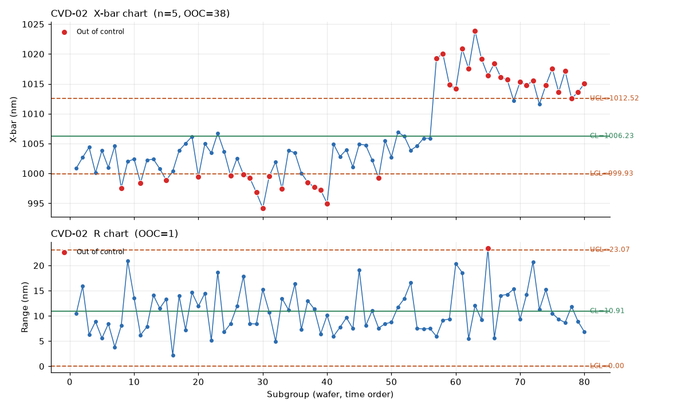

# spc-report

반도체 공정 측정 데이터(웨이퍼별 막 두께)를 모아 **SPC(Statistical Process Control, 통계적 공정 관리) 리포트**를 엑셀 파일로 자동 생성하는 Python 프로젝트입니다.

- 폴더 안의 측정 엑셀 파일을 모두 합쳐서
- 장비별 평균/표준편차 요약표와
- 장비별 **X-bar–R 관리도**(UCL/LCL 표시, 관리 한계를 벗어난 점 강조)를 만들고
- 결과를 엑셀 리포트 파일 하나로 저장합니다.

실제 데이터가 없어도 연습할 수 있도록, 이상치를 섞은 **가상 측정 데이터 생성기**를 함께 제공합니다.



> 위 예시에서 CVD-02는 57번째 서브그룹부터 평균이 +12 nm 이동하도록 데이터를 만들었습니다. 이동 이후의 점들이 UCL 위로 연속해서 나타나 빨간색으로 강조된 것을 볼 수 있습니다.

## X-bar–R 관리도

- **서브그룹** = 웨이퍼 1장 (측정 포인트 n = 5)
- **X-bar 관리도** (공정 평균 감시): CL = X̿, UCL/LCL = X̿ ± A₂·R̄
- **R 관리도** (공정 산포 감시): CL = R̄, UCL = D₄·R̄, LCL = D₃·R̄
- n = 5일 때 사용하는 상수: A₂ = 0.577, D₃ = 0, D₄ = 2.114
- 장비마다 평균 수준이 달라서 관리 한계는 **장비별로 따로** 계산합니다.

## 설치

[uv](https://docs.astral.sh/uv/)가 필요합니다. 필요한 Python 버전은 3.12 이상입니다.

```bash
git clone https://github.com/jihun001519-cloud/spc-report.git
cd spc-report
uv sync
```

## 사용법

```bash
# 1) 가상 측정 데이터 생성: data/ 폴더에 날짜별 엑셀 파일 10개를 만듭니다
uv run spc-generate --out data --days 10 --seed 42

# 2) 리포트 생성: data/ 폴더의 엑셀 파일을 모두 합쳐 리포트 하나로 저장합니다
uv run spc-report --in data --out output/spc_report.xlsx

# 테스트 실행
uv run pytest
```

| 명령 | 옵션 | 기본값 | 설명 |
|---|---|---|---|
| `spc-generate` | `--out` | `data` | 생성한 파일을 저장할 폴더 |
| | `--days` | `10` | 생성할 일수 (= 파일 개수) |
| | `--wafers` | `8` | LOT당 웨이퍼 수 |
| | `--seed` | `42` | 난수 시드 (같은 값이면 같은 데이터가 나옴) |
| `spc-report` | `--in` | `data` | 측정 엑셀 파일이 있는 폴더 |
| | `--out` | `output/spc_report.xlsx` | 리포트 파일 경로 |

### 입력 데이터 형식

입력 엑셀 파일에는 아래 컬럼이 모두 있어야 합니다. 필수 컬럼이 빠진 파일은 경고를 띄우고 건너뜁니다.

| 컬럼 | 예시 | 설명 |
|---|---|---|
| `date` | 2026-11-01 | 측정일 |
| `lot_id` | LOT2611001 | LOT ID |
| `wafer_id` | 1 ~ 8 | 웨이퍼 번호 |
| `equipment_id` | CVD-01 | 장비 ID |
| `site` | 1 ~ 5 | 웨이퍼 내 측정 포인트 |
| `thickness_nm` | 1001.23 | 막 두께 (nm) |

### 가상 데이터에 섞인 이상치

- **스파이크**: 일부 웨이퍼의 두께가 ±6σ만큼 튑니다 (약 2% 확률).
- **평균 이동**: `CVD-02`의 평균이 7일째부터 +12 nm 이동합니다.

## 리포트 시트 구성

| 시트 | 내용 |
|---|---|
| `Summary` | 장비별 요약통계(N, 평균, 표준편차, 최소, 최대, 범위)와 관리 한계, 관리 한계를 벗어난 점의 개수 |
| `XbarR_<장비>` | X-bar–R 관리도 이미지와 서브그룹별 X̄·R 표. 관리 한계를 벗어난 행은 빨간색으로 강조 |
| `OOC_List` | 관리 한계를 벗어난(OOC) 서브그룹 전체 목록 (장비, 날짜, LOT, 웨이퍼, 원인) |
| `RawData` | 합쳐진 원본 측정 데이터 (어느 파일에서 왔는지 포함) |

## 프로젝트 구조

```
src/spc_report/
├── config.py     # 컬럼명, 경로, 장비별 성향, SPC 상수(A2, D3, D4)
├── generate.py   # 가상 측정 데이터 생성 → 날짜별 엑셀
├── loader.py     # 폴더 내 엑셀을 모두 읽어 합치고 검증
├── stats.py      # 요약통계, 서브그룹, 관리 한계, OOC 판정
├── chart.py      # X-bar–R 관리도 PNG 생성 (matplotlib)
├── report.py     # 엑셀 리포트 작성 (openpyxl)
└── cli.py        # spc-generate / spc-report 명령어
tests/            # pytest
```

## 알아둘 점

- 관리 한계는 입력 데이터 **전체**로 계산합니다(Phase I 방식). 그래서 데이터 중간에 평균이 이동하면 CL이 이동 전과 후 사이에 걸리고, 이동 전 구간의 점도 LCL을 벗어날 수 있습니다. 안정 구간으로 한계를 먼저 정한 뒤 새 데이터를 감시하는 기능(Phase II)은 아직 없습니다.
- X-bar 관리 한계는 웨이퍼 *안의* 산포(R̄)로만 계산합니다. LOT 간 산포가 크면 정상 데이터도 관리 한계를 벗어난 것으로 판정될 수 있습니다.
